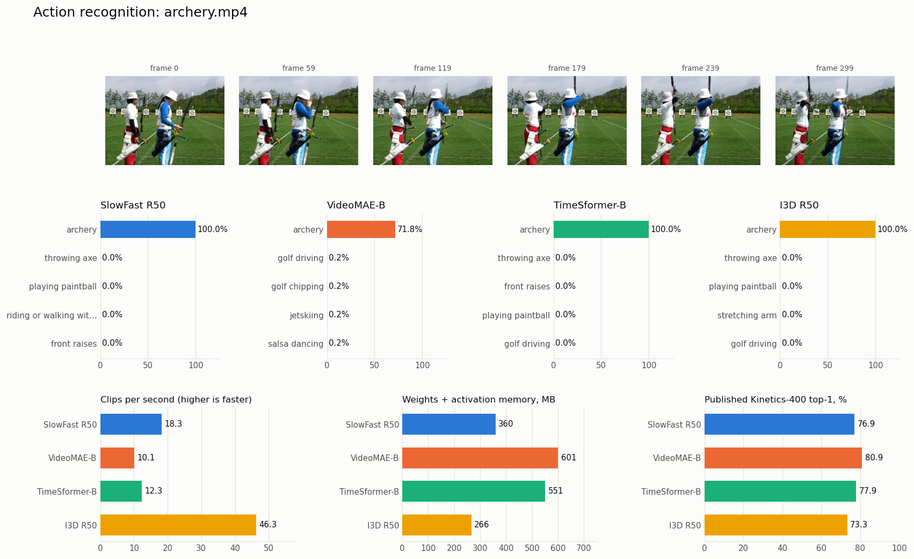
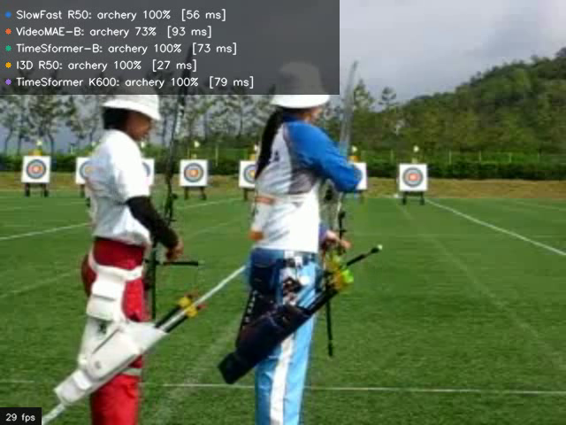

# Video Action Recognition: SlowFast vs VideoMAE vs TimeSformer vs I3D

[](https://github.com/eliftb/video-action-recognition/actions/workflows/tests.yml)

[Türkçe](README.tr.md)

Runs a video through four pretrained Kinetics-400 action recognition models.
For each model it shows the predicted action and its confidence, then compares
speed and memory use. It also writes a summary figure and an annotated copy of
the video.



| Model | Family | Checkpoint | Input clip |
|---|---|---|---|
| **SlowFast R50** | two-pathway 3D CNN | PyTorchVideo `slowfast_r50` | 32 frames (fast) / 8 (slow), stride 2, 256px |
| **VideoMAE-B** | ViT, masked-autoencoder pretraining | `MCG-NJU/videomae-base-finetuned-kinetics` | 16 frames, stride 4, 224px |
| **TimeSformer-B** | ViT, divided space-time attention | `facebook/timesformer-base-finetuned-k400` | 8 frames, stride 32, 224px |
| **I3D R50** | inflated 2D→3D CNN | PyTorchVideo `i3d_r50` | 8 frames, stride 8, 224px |

All four share the same 400 Kinetics classes, so their predictions are directly comparable.

## Quick start

```bash
source env.sh                 # venv + keeps HF/torch caches inside this folder
python demo.py                # bundled archery clip
python demo.py --video assets/archery.mp4 assets/eating_spaghetti.mp4
python demo.py --url "https://www.youtube.com/watch?v=..."   # needs: pip install yt-dlp
python demo.py --models videomae i3d --no-benchmark          # subset, skip timing
python demo.py --half         # fp16 on GPU
```

Fresh setup elsewhere: `python -m venv .venv && source env.sh && pip install -r requirements.txt`.
The first run downloads about 1.5 GB of weights.

Outputs go to `outputs/`:
- `<video>_results.png`: sampled frames, top-5 per model, and the speed/memory/accuracy comparison
- `<video>_annotated.mp4`: the video with every model's top-1 prediction overlaid
- `<video>_report.json`: all predictions and metrics as machine-readable data

## Real-time webcam mode

```bash
python webcam.py                          # camera 0, all five models side by side
python webcam.py --models videomae        # one model: top-3 classes with confidence bars
python webcam.py --source 1               # another camera
python webcam.py --source assets/archery.mp4   # no camera: loop a file through the same pipeline
python webcam.py --record outputs/live.mp4     # also save the annotated picture
```

Press `q` or `Esc` to quit.



*The live overlay, here with the archery sample clip looped through the pipeline (`--source assets/archery.mp4`) instead of a camera.*

How it works:
- The last few seconds of camera frames are kept in a buffer with their timestamps.
- A background thread keeps taking the newest window from the buffer and runs each model on it. Frames are picked by timestamp, so the clip has the right speed whatever frame rate the camera delivers.
- Each model sees its native time span (about 2.1 s), capped at 3 s (`--max-window`). The cap only affects TimeSformer, whose native span is 8.5 s, which is too slow to follow a change of action.
- Class probabilities are averaged over consecutive windows (`--smoothing`) so the label does not flicker. Predictions under 30% are drawn dimmed.
- The picture is drawn by the main thread, so it stays smooth while the models run.

With all five models on the RTX 4060 Laptop GPU, each prediction refreshes about 3 times per second; VideoMAE alone refreshes about 10 times per second. After you change action, expect the label to follow in about 2 to 3 seconds, because the window has to fill with the new action.

The four comparison models know only the 400 Kinetics classes (for example drinking, clapping, shaking head, push up, playing guitar, brushing teeth). The webcam mode adds a fifth model, TimeSformer trained on Kinetics-600 (`--models timesformer-k600`), because its 600 classes include everyday gestures that Kinetics-400 lacks, such as "waving hand". Every model always picks one of its classes, even when nothing is happening.

## Pipeline

```
video ─► read_video (OpenCV, RGB)
      ─► clip_indices  (centre clip: num_frames × sampling_rate per model)
      ─► frames_to_clip (resize short side → centre crop → normalise, on GPU)
      ─► to_model_input (SlowFast: [slow, fast] · HF: (B,T,C,H,W) · I3D: (B,C,T,H,W))
      ─► model ─► softmax ─► top-5 labels + probabilities
```

| File | Role |
|---|---|
| `actionrec/config.py` | per-model specs (frames, stride, crop, mean/std, published accuracy) |
| `actionrec/video.py` | decoding, clip sampling, URL/YouTube download |
| `actionrec/preprocess.py` | shared preprocessing |
| `actionrec/models.py` | `ActionRecognizer` wraps torch.hub and transformers models behind one interface |
| `actionrec/benchmark.py` | latency, throughput, memory |
| `actionrec/visualize.py` | summary figure and annotated video |
| `demo.py` | CLI and `run_demo()` |
| `evaluate.py` | measures top-1/top-5 on your own labelled videos |

## Results on this machine

RTX 4060 Laptop GPU (8 GB), PyTorch 2.0.1, fp32, batch size 1, mean of 10 runs, `eating_spaghetti.mp4`:

| Model | Params | Forward | End-to-end | Clips/s | Weights | Activation mem | Published K400 top-1 |
|---|---|---|---|---|---|---|---|
| SlowFast R50 | 34.6M | 49.7 ms | 62.5 ms | 16.0 | 132 MB | 228 MB | 76.9% |
| VideoMAE-B | 86.5M | 96.9 ms | 102.3 ms | 9.8 | 330 MB | 271 MB | 80.9% |
| TimeSformer-B | 121.6M | 80.1 ms | 82.6 ms | 12.1 | 464 MB | 88 MB | 77.9% |
| I3D R50 | 28.0M | 20.3 ms | 22.7 ms | 44.1 | 107 MB | 159 MB | 73.3% |

Predictions:

| Video | SlowFast | VideoMAE | TimeSformer | I3D |
|---|---|---|---|---|
| archery.mp4 | archery 100% | archery 72% | archery 100% | archery 100% |
| eating_spaghetti.mp4 | eating spaghetti 97% | eating spaghetti 74% | eating spaghetti 99% | eating spaghetti 64% (dining 21%) |

Your timings will differ by GPU. Re-run `python demo.py` to measure on your own hardware.

### About the accuracy column

The accuracy numbers come from published sources and were **not measured by this project**:
- SlowFast and I3D: the [PyTorchVideo model zoo](https://github.com/facebookresearch/pytorchvideo/blob/main/docs/source/model_zoo.md), 8×8 clips, 3×10 views
- VideoMAE: the [Hugging Face model card](https://huggingface.co/MCG-NJU/videomae-base-finetuned-kinetics)
- TimeSformer: the [official model zoo](https://github.com/facebookresearch/TimeSformer), 8×32 clips, 1×3 views

Those numbers average predictions over several clips and crops. This demo uses a
single centre clip, so you should expect a few points lower. To measure accuracy
yourself, put videos in `data/eval/<kinetics class name>/` and run `python evaluate.py data/eval`.

Two side notes. A confidence score is not accuracy: VideoMAE is usually less
confident than the others even when it is correct. Fps is also not a single
number here: "clips/s" is how many predictions per second the model can make,
and "frames/s" (shown in the terminal) is clips/s × input frames.

## 5–6 minute demo script

1. **(0:00–0:45) Problem.** Classifying actions in video is harder than in images because motion matters: "opening" and "closing" a door can look identical in a single frame. All four models here were trained on Kinetics-400, which has 400 human actions.
2. **(0:45–2:00) Four architectures.** I3D inflates 2D ImageNet filters into 3D. SlowFast runs two pathways: a slow one for appearance and a fast one for motion. TimeSformer replaces convolutions with attention split into time and space. VideoMAE is also a ViT, but it is pretrained by reconstructing 90% masked video patches.
3. **(2:00–3:30) Live run.** `python demo.py --video assets/archery.mp4 assets/eating_spaghetti.mp4`. Models load once and the run takes about 50 s. Point out that all four agree, but their confidence differs, for example I3D's 21% on "dining".
4. **(3:30–4:30) Results figure.** Open `outputs/eating_spaghetti_results.png`. Its rows show the frames the models saw, each model's top-5, and the trade-off.
5. **(4:30–5:30) Trade-off.** I3D is about 4× faster than VideoMAE but has the lowest published accuracy. VideoMAE has the highest published accuracy and is the slowest. SlowFast is the best middle ground among the CNNs. Close by playing `outputs/eating_spaghetti_annotated.mp4`.
6. **(5:30–6:00) Extensibility.** Any YouTube link works with `--url`, and you can measure real accuracy on your own data with `evaluate.py`.

Tip: run `python demo.py` once before presenting so the weights are cached and the GPU is warm.

## Tests

```bash
PYTEST_DISABLE_PLUGIN_AUTOLOAD=1 python -m pytest -q tests   # the env var is only needed if ROS is installed
```

The tests cover clip sampling, tensor shapes and normalisation for every model, the SlowFast pathway split, the label mapping, and the live mode's frame buffer, time-based sampling, smoothing and overlay. They do not need the model weights or a camera.

GitHub Actions runs them on every push and pull request (Python 3.10 and 3.12, CPU-only PyTorch from `requirements-ci.txt`), and checks that the three scripts start.

## Sample videos

The sample videos are not stored in the repo. They are downloaded into `assets/` the first time you run the demo:
- `archery.mp4`: PyTorchVideo tutorial clip (`dl.fbaipublicfiles.com/pytorchvideo/projects/archery.mp4`)
- `eating_spaghetti.mp4`: Hugging Face `nielsr/video-demo` dataset, used in the transformers docs

## Roadmap

- Top-1 accuracy measured with `evaluate.py` on a Kinetics-400 validation subset
