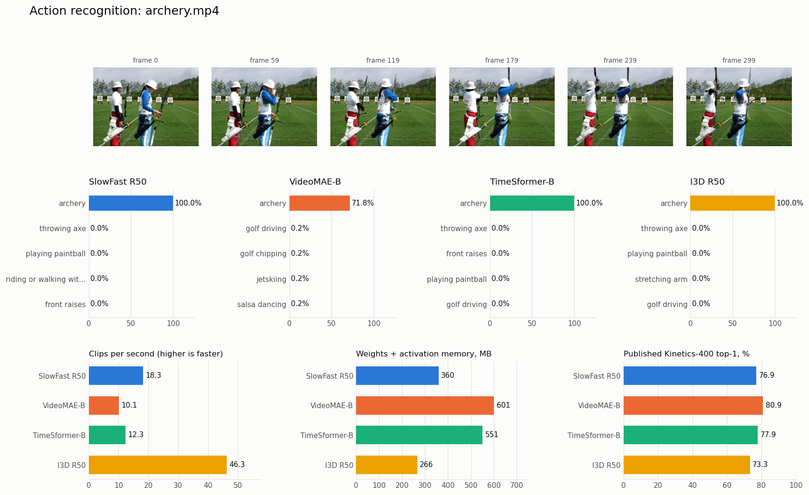

# Videoda Eylem Tanıma: SlowFast, VideoMAE, TimeSformer ve I3D

[English](README.md)

Bir videoyu Kinetics-400 ile eğitilmiş dört hazır modelden geçirir. Her modelin
tahmin ettiği eylemi ve güven oranını gösterir, modellerin hızını ve bellek
kullanımını karşılaştırır. Ayrıca bir özet görseli ve tahminlerin üzerine
yazıldığı bir video kaydeder.



| Model | Mimari | Girdi |
|---|---|---|
| **SlowFast R50** | iki yollu 3B CNN (yavaş yol: görünüş, hızlı yol: hareket) | 32/8 kare, 256px |
| **VideoMAE-B** | maskeli otokodlayıcıyla ön eğitilmiş ViT | 16 kare, 224px |
| **TimeSformer-B** | zaman ve uzayda ayrık dikkat kullanan ViT | 8 kare, 224px |
| **I3D R50** | 2B filtreleri 3B'ye "şişiren" CNN | 8 kare, 224px |

## Çalıştırma

```bash
source env.sh                 # sanal ortamı açar, model önbelleklerini proje klasörüne yönlendirir
python demo.py                # okçuluk örneği (ilk çalıştırmada indirilir)
python demo.py --video assets/eating_spaghetti.mp4
python demo.py --video benim_videom.mp4
python demo.py --url "https://www.youtube.com/watch?v=..."   # yt-dlp gerekir
python demo.py --models videomae i3d --no-benchmark
```

Sıfırdan kurulum: `python -m venv .venv && source env.sh && pip install -r requirements.txt`.
İlk çalıştırma yaklaşık 1,5 GB model ağırlığı indirir.

Çıktılar `outputs/` klasörüne yazılır: özet görseli (`_results.png`), tahminlerin
yazılı olduğu video (`_annotated.mp4`) ve tüm sonuçları içeren JSON rapor (`_report.json`).

## Bu makinedeki sonuçlar

RTX 4060 Laptop GPU, fp32, batch boyutu 1, 10 çalıştırmanın ortalaması:

| Model | Parametre | Klip/sn | Ağırlık + aktivasyon belleği | Yayımlanan K400 top-1 |
|---|---|---|---|---|
| SlowFast R50 | 34.6M | 16.0 | 360 MB | 76.9% |
| VideoMAE-B | 86.5M | 9.8 | 601 MB | 80.9% |
| TimeSformer-B | 121.6M | 12.1 | 551 MB | 77.9% |
| I3D R50 | 28.0M | 44.1 | 266 MB | 73.3% |

Doğruluk sütunu **yayımlanmış** değerlerdir ve bu projede ölçülmemiştir.
Kaynaklar [README.md](README.md) içinde verilmiştir. Bu değerler her videodan
birden çok klip ve kırpma alınarak hesaplanmıştır; bu demo tek bir merkez klip
kullandığı için birkaç puan daha düşük sonuç beklenmelidir. Kendi etiketli
videolarınızda doğruluğu ölçmek için `python evaluate.py data/eval` kullanın.

## Testler

```bash
PYTEST_DISABLE_PLUGIN_AUTOLOAD=1 python -m pytest -q tests
```

Testler model ağırlıklarına ihtiyaç duymaz.

## Yol haritası

- Web kamerasıyla gerçek zamanlı tahmin
- GitHub Actions CI
- Kinetics-400 doğrulama alt kümesinde `evaluate.py` ile ölçülmüş doğruluk
